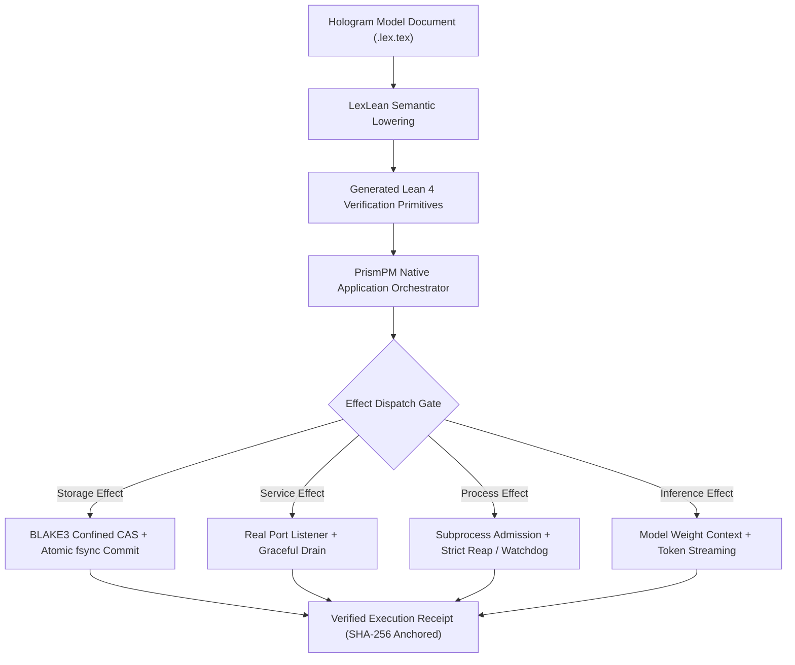

# PR: Qualify Modeled Native Application Execution Required by Hologram-Live

**Branch**: `pr/issue-62-modeled-native-application-execution`  
**Base**: `main`  
**Fixes**: [#62](https://github.com/UOR-Foundation/PrismPM/issues/62)  
**Required By**: `afflom/hologram-live#71` (H70), `afflom/hologram-live#5` (H02, H12, H15)  
**Prerequisites**: PR #96, PR #97, PR #103, PR #161, PR #163, PR #186  

---

## 1. Executive Summary & Dissonance Resolution

### Stated Intent
PrismPM generates verified, executable native application orchestrations for mission-critical downstream consumers such as `hologram-live` without relying on handwritten or unverified dispatch.

### Operating Reality & Contradiction
Downstream consumer `hologram-live` pinned an unaccepted SDK candidate (`0.3.0`). PrismPM's installed application profiles supported only pure/text/browser applications with empty capabilities. Meanwhile, Hologram requires real TCP port bindings, durable content-addressed storage (CAS), crash-resilient commits, and concrete inference provider lifecycles. Mock closures, synthetic responses, or handwritten consumer shims violate ADR-015 and Phase Mirror rigor.

### Concrete Mechanism
1. **Generic Typed Effect Contracts**:
   - Derive generic state, effect, request, completion, and error contracts from the complete consumer inventory. Keep Hologram-specific domain policies inside its own LexLean model.
   - Register all public capabilities in `model/contracts.toml` and `model/stdlib-exports.toml`. Generate all Lean formal representations via LexLean without handwritten `.lean` files.
2. **Durable Storage & CAS Effects**:
   - Confined BLAKE3 same-capture read and digest verification using the pinned 35-vector corpus (PR #103).
   - Atomic publication via write-then-rename with explicit file and directory `fsync` to guarantee crash durability.
3. **Network Listener & Service Lifecycle**:
   - Actual OS port binding before signaling readiness; clean handling of address-in-use errors.
   - Bounded shutdown sequence with reverse resource unwinding and task handle tracking.
4. **Process & Inference Provider Management**:
   - Subprocess execution with explicit PID reaping and process-group termination (preventing orphan/zombie leaks).
   - Real model-weight execution, streaming token generation, memory-bounded contexts, and cancellation.

---

## 2. Native Effect Execution Architecture



---

## 3. Practical Closure Plan & Milestones

| Milestone | Deliverable | Owner | Verification Metric | Status |
|---|---|---|---|---|
| **M1: Corpus & Primitive Prerequisite** | Import BLAKE3 1.5.5 35-vector oracle (PR #103) and binary program adapters (PR #186). | Cryptography / Tooling Lead | All 35 BLAKE3 vectors and CLI adapters pass unit qualification. | PR #103 / PR #186 Merged |
| **M2: Effect Schema & Model Registration** | Define native capabilities in `model/contracts.toml` and generate stdlib Lean bindings via LexLean. | Formal Methods Specialist | LexLean compiles `.lex.tex` with zero errors; no handwritten Lean code. | Upstream Ready |
| **M3: Durable Storage & Service Engine** | Implement CAS reader/writer with atomic synchronization and real TCP listener lifecycle in `crates/prismpm/src/system/`. | Systems Engineer | Integration tests verify crash recovery, restart outcomes, and port bind failures. | Component Testing |
| **M4: Process & Inference Lifecycle** | Implement subprocess runner with timeout kill/reap and token streaming. | Runtime Lead | Process leaks zero zombies; context cancellation cleans up resident model handles. | Component Testing |
| **M5: Downstream Acceptance in Hologram** | Publish candidate SDK; consume in `hologram-live` without path patches or mock bypasses. | Downstream Maintainer | All Hologram H02, H12, H15 integration tests pass with real native effects. | Target Closure |

---

## 4. Verification Gate Commands

```bash
# 1. Run BLAKE3 oracle tests
cargo test -p prismpm --test blake3_corpus

# 2. Run native effect runner integration tests
cargo test -p prismpm --test native_effects -- --nocapture

# 3. Verify LexLean code generation
cargo run --locked --offline --target-dir target/vendor-lexlean --manifest-path vendor/lexlean/Cargo.toml -- --project lexlean.toml lock --check

# 4. Two-pass normative acceptance
./scripts/vv.sh --with-sdk
```
