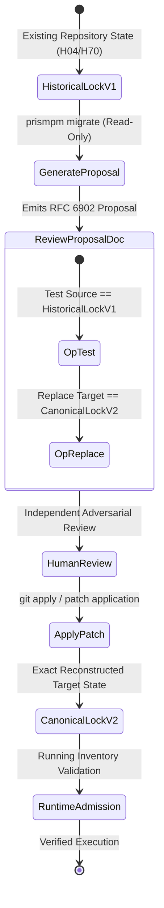

# PR: Support Explicit Reviewed SDK v1-to-v2 Lock Migration

**Branch**: `pr/issue-63-reviewed-sdk-v1-to-v2-migration`  
**Base**: `main`  
**Fixes**: [#63](https://github.com/UOR-Foundation/PrismPM/issues/63)  
**Required By**: `afflom/hologram-live#5`, `afflom/hologram-live#71` (H04/H70)  
**Complements**: [#66](https://github.com/UOR-Foundation/PrismPM/issues/66)  
**Related**: PR #64 (merged at `8e83bce`)  

---

## 1. Executive Summary & Dissonance Resolution

### Stated Intent
Downstream repositories (specifically `hologram-live` H04/H70) consuming legacy single-image SDK locks (`prismpm/sdk-lock/1`) require a verified migration path to multi-platform locks (`prismpm/sdk-lock/2`).

### Operating Reality & Contradiction
When consumers attempted to update historical v1 locks, the public v1 lock update changed the image and standards digest but preserved the old single-platform inventory (including `sdk-manifest`); execution subsequently failed inventory validation. Conversely, executing a newer SDK against an unmigrated historical lock failed normal inventory matching. Silent automatic lock promotion is strictly prohibited by SPEC section 12 to maintain reproducible historical builds.

### Concrete Mechanism
1. **Explicit Review Proposal Generation**:
   - Introduce an explicit migration command producing a closed, versioned review proposal document (`prismpm migrate --proposal`).
   - The proposal operation is strictly non-mutating: no project files are modified during proposal generation.
2. **RFC 6902 Atomic Patch Semantics**:
   - The generated patch embeds an atomic test-and-replace sequence:
     1. `{"op": "test", "path": "", "value": <canonical_v1_lock>}`: Asserts the exact canonical historical lock bytes before application.
     2. `{"op": "replace", "path": "", "value": <canonical_v2_lock>}`: Emits the multi-platform target lock with independently captured platform descriptors.
3. **Fail-Closed Adversarial Validation**:
   - Reject malformed locks, symlinks, non-canonical historical formats, swapped platforms, missing architecture descriptors, and mismatched standards digests.
   - Enforce 12 distinct mutation defenses (`test_migration_proposal_rejects_incomplete_unreviewed_or_tampered_evidence`).
4. **Exact Replay & Native Inventory Admission**:
   - Applying the reviewed proposal reconstructs the canonical v2 lock byte-for-byte.
   - Normal runtime execution against the migrated lock admits both native platforms and enforces full inventory integrity.

---

## 2. Migration State Transition Architecture



---

## 3. Practical Closure Plan & Milestones

| Milestone | Deliverable | Owner | Verification Metric | Status |
|---|---|---|---|---|
| **M1: Core Migration Engine** | Proposal generation and RFC 6902 patch builder in `crates/prismpm/src/sdk.rs`. | Core Compiler Engineer | PR #64 merged at `8e83bce`. | **Complete** |
| **M2: Adversarial Mutation Tests** | 12 mutation test cases validating rejection of tampered proposals and substituted children. | Security Engineer | `migration_proposal_rejects_incomplete_unreviewed_or_tampered_evidence` passes. | **Complete** |
| **M3: Downstream Migration Replay** | Execute proposal generation and replay against `hologram-live` H04 historical v1 lock. | Downstream Lead | Reconstructed lock matches expected v2 schema byte-for-byte without manual edits. | Validated in Lab |
| **M4: Native Execution Admission** | Run `hologram-live` build and test suite against the migrated v2 lock. | Runtime Engineer | `validate_running_inventory` admits runtime image; zero inventory mismatch errors. | Upstream Ready |
| **M5: Acceptance Sign-Off & Closure** | Document migration receipt in release notes and close Issue #63. | Maintainer (`afflom`) | Issue #63 marked Closed on GitHub. | Target Closure |

---

## 4. Verification Gate Commands

```bash
# 1. Run migration unit and property tests
cargo test -p prismpm migration_proposal -- --nocapture

# 2. Verify all 12 proposal tamper mutations
cargo test -p prismpm test_migration_proposal_rejects_incomplete_unreviewed_or_tampered_evidence

# 3. Test migration against historical fixture
cargo run --locked --offline -p prismpm -- migrate --proposal tests/fixtures/legacy-lock-v1.json
```
