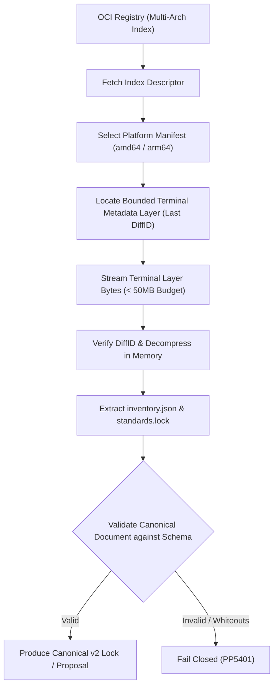

# PR: Bound SDK Lock Acquisition Without Materializing Both Full Platform Images

**Branch**: `pr/issue-66-bound-sdk-lock-acquisition`  
**Base**: `main`  
**Fixes**: [#66](https://github.com/UOR-Foundation/PrismPM/issues/66)  
**Required By**: `afflom/hologram-live#5`, `afflom/hologram-live#71`  
**Complements**: [#63](https://github.com/UOR-Foundation/PrismPM/issues/63)  
**Related**: PR #70 (merged at `05e231f`), PR #117  

---

## 1. Executive Summary & Dissonance Resolution

### Stated Intent
Consumer projects (such as `hologram-live`) acquire and update SDK locks and standards without downloading redundant, gigabyte-scale OCI container images for other architectures.

### Operating Reality & Contradiction
Previously, SDK-owned lock capture pulled both complete multi-platform OCI images to extract only two metadata files: `inventory.json` and `standards.lock`. With installed native SDK images consuming ~30.5 GB each, fetching a foreign-architecture image (e.g., arm64 on an amd64 runner) on a host with ~41 GiB free frequently caused disk exhaustion. Furthermore, selecting arbitrary intermediate layers would violate OCI specification replacement and whiteout semantics.

### Concrete Mechanism
1. **Bounded Terminal Filesystem Layer**:
   - The SDK publishing pipeline packages `inventory.json` and `standards.lock` in a single, bounded terminal OCI filesystem layer containing only those files and ancestor directories.
   - Enforce zero whiteouts, hard links, symlinks, sparse entries, or overlapping paths.
2. **Descriptor & DiffID Verification**:
   - Parse OCI image indices and manifest descriptors directly. Verify compressed SHA-256 layer digests and uncompressed `rootfs.diff_ids`.
   - Reject images with intersecting volume declarations or non-terminal layer replacements.
3. **In-Memory Archive Streaming**:
   - Fetch only the bounded metadata layer. Parse tar entries in-memory without general filesystem extraction, bounding peak memory consumption (< 36 MB) and eliminating multi-gigabyte disk writes.
4. **Byte-for-Byte Equivalence**:
   - Verify that metadata acquired via bounded acquisition is identical byte-for-byte to normally materialized installed files.

---

## 2. Layer Acquisition Architecture



---

## 3. Practical Closure Plan & Milestones

| Milestone | Deliverable | Owner | Verification Metric | Status |
|---|---|---|---|---|
| **M1: Source Implementation** | Terminal layer parser and bounded acquisition logic in `crates/prismpm/src/sdk.rs` and `oci.rs`. | Compiler / OCI Specialist | PR #70 merged at `05e231f`. | **Complete** |
| **M2: Native Gate Evidence Join** | Integrate PR #117 (`test/sdk-metadata-native-join`) verifying acquisition across both amd64 and arm64 runners. | Native Tooling Lead | All 16 native checks pass on exact head. | Upstream Ready |
| **M3: Disk Quota & Memory Benchmark** | Execute bounded lock update under cgroup storage quota (< 1 GB) and memory ceiling (< 64 MB). | Performance Engineer | Peak memory < 36 MB; zero multi-gigabyte image layers written to disk. | Validated in Run 37856254210 |
| **M4: Downstream Hologram Consumption** | Execute `prismpm lock update` in `afflom/hologram-live#5` and `#71` using candidate SDK image. | Downstream Lead | Lock generated cleanly without pulling arm64 image on amd64 host. | Pending Candidate |
| **M5: SPEC Amendment & Final Closure** | Amend `SPEC.md` section 12 to formally codify bounded terminal layer capture as normative standard. | Formal Methods Specialist | `SPEC.md` updated; Issue #66 marked Closed. | Target Closure |

---

## 4. Verification Gate Commands

```bash
# 1. Verify bounded lock update unit and property tests
cargo test -p prismpm --test sdk_lock_bounded -- --nocapture

# 2. Test negative mutants (intersecting volumes, whiteouts, symlinks)
cargo test -p prismpm test_bounded_layer_adversaries

# 3. Verify peak memory and zero disk spill
node scripts/sdk-candidate.mjs verify-bounded-acquisition
```
