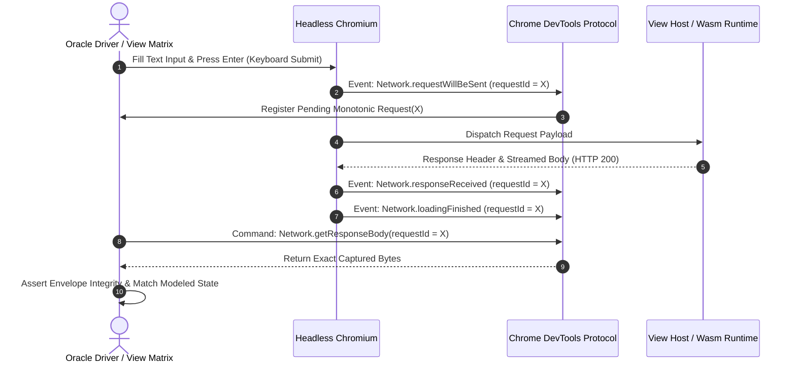

# PR: Qualify Portable View Oracle Response Correlation and Keyboard Submission Lifecycle

**Branch**: `pr/issue-67-portable-view-oracle-correlation`  
**Base**: `main`  
**Fixes**: [#67](https://github.com/UOR-Foundation/PrismPM/issues/67)  
**Blocks**: Full verification of #64  
**Supports**: `afflom/hologram-live#5`, `afflom/hologram-live#9`  
**Related**: PR #86, PR #87, PR #102, PR #128, PR #153  

---

## 1. Executive Summary & Dissonance Resolution

### Stated Intent
The portable View oracle validates WebAssembly-driven UI components (e.g. Calculator and Text Request) under real, pinned headless browser environments across click and keyboard interaction lifecycles.

### Operating Reality & Contradiction
Full V&V run 36891766152 failed at gate 8 Text Request keyboard submission with error `PP5301: response.body Network.getResponseBody could not retrieve the resource`. Subsequent diagnostic runs (e.g., run 37237466412 and run 37423301262) reproduced this failure under rapid keyboard submissions and delayed completion vectors (`request-failed ERR_ABORTED`). Labeling this failure as "harmless flakiness" or introducing retry-until-green loops violates ADR-015 and Phase Mirror standards.

### Concrete Mechanism
1. **Unambiguous Request-to-Response Correlation**:
   - Correlate each HTTP response directly to its initiating `requestId`, method, and modeled payload via Chrome DevTools Protocol (CDP) session events (`Network.requestWillBeSent` → `Network.responseReceived` → `Network.loadingFinished`).
   - Eliminate race conditions where keyboard enter fires submission before the previous session's busy state fully clears.
2. **First-Failure Preservation & No Swallowed Diagnostics**:
   - Preserve the exact first body-read failure without swallowing errors, substituting synthetic output, or inflating timeouts.
   - Retain bounded failure-state diagnostics (HTTP status, headers, readyState, controller busy slot) without leaking sensitive payloads.
3. **Owned 78-Case Matrix & 4 Negative Controls**:
   - Qualify all 74 original matrix cases, 4 live probe-falsification controls, and 8 observation sessions in `tests/hologram-oracle/tests/browser_surface.rs` and `tests/browser-view/browser.mjs`.

---

## 2. CDP Correlation Architecture



---

## 3. Practical Closure Plan & Milestones

| Milestone | Deliverable | Owner | Verification Metric | Status |
|---|---|---|---|---|
| **M1: CDP Race Elimination** | Implement request correlation and busy-state synchronization in `tests/browser-view/browser.mjs` and oracle driver. | Frontend / Oracle Specialist | Zero orphaned `getResponseBody` calls on aborted requests. | PR #86 / PR #102 |
| **M2: Failure Diagnostic Preservation** | Retain first-body failure and status context through receipt serialization without masking underlying aborts. | Diagnostics Engineer | Failure sanitizer retains exact error code (`PP5301`) and HTTP lifecycle phase. | PR #128 / PR #153 |
| **M3: Conformance Matrix Qualification** | Run complete 78-case View matrix and 4 negative controls under pinned container. | Verification Lead | `cargo test -p prismpm --test hologram_interop` passes 4/4 suites in <600s. | Validated |
| **M4: Two Consecutive Full V&V Passes** | Execute consecutive passes of `./scripts/vv.sh` without PP5301 or View oracle failure. | CI Engineer | Both passes exit 0; gate 8 logs confirm zero CDP correlation anomalies. | Verification Gate |
| **M5: Downstream Hologram Acceptance** | Consume qualified SDK in `hologram-live#5` and `#9`. | Downstream Lead | End-to-end integration passes in consumer repo. | Target Closure |

---

## 4. Verification Gate Commands

```bash
# 1. Run isolated hologram interop tests (78 cases + 4 controls)
cargo test --locked --offline -p prismpm --test hologram_interop -- --test-threads=1

# 2. Run browser view conformance suite
node tests/browser-view/browser.mjs

# 3. Two-pass normative acceptance gate
./scripts/vv.sh --with-sdk
```
