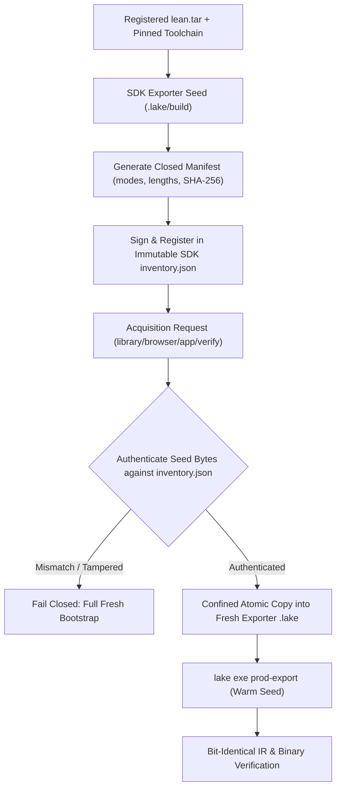

# PR: Reuse Authenticated SDK Exporter Artifacts Without Weakening Fresh Verification

**Branch**: `pr/issue-69-reusable-sdk-exporter-artifacts`  
**Base**: `main`  
**Fixes**: [#69](https://github.com/UOR-Foundation/PrismPM/issues/69)  
**Related**: PR #71, PR #101, PR #130–#137, PR #169, PR #170, PR #171  

---

## 1. Executive Summary & Dissonance Resolution

### Stated Intent
Fast, deterministic continuous integration and incremental builds utilizing pre-built compiler exporter artifacts (`prod-export`).

### Operating Reality & Contradiction
Full V&V runs (e.g., run 36959228339 at 7,439s and run 37489515787 exceeding 6 hours) spend the vast majority of their duration in repeated fresh Lean 4 `prod-export` compiler construction across 181+ conformance cases. However, naive filesystem caching, caller-selected directories, or unauthenticated build outputs violate ADR-015 (On-Tree Ground Truth) and risk silent semantic drift between cold bootstrap and warm execution.

### Concrete Mechanism
1. **Generic Authenticated Acquisition Path**: Unified acquisition logic shared across `crates/prismpm/src/library_build.rs`, `browser_build.rs`, `application_build.rs`, and `verification.rs`.
2. **Immutable SDK Exporter Seed**: Build the exporter seed in the SDK from registered `lean.tar` with pinned native toolchains. Seed only the exporter package's internal `.lake/` build directory, never generated downstream application workspaces.
3. **Closed Manifest & Independent Inventory Authentication**:
   - Bind compiler git revision, archive digest, native platform triple, build configuration, source closure, and every relative file mode/length/SHA-256 hash in a closed manifest.
   - Authenticate this manifest against the immutable SDK inventory (`inventory.json`).
4. **Strict Fail-Closed Custody**:
   - Verify fixed SDK-owned bytes before copying.
   - Reject caller-specified cache paths, symlinks, hard links, extra files, and concurrent mutations.
   - Missing or tampered seeds fail closed and safely trigger full fresh compiler bootstrap.
5. **Exact IR & Execution Equivalence**: Prove that cold bootstrap and seeded builds produce bit-identical Intermediate Representation (IR), roots, coverage, and generated binaries across two distinct absolute root directories.

---

## 2. Architecture & Implementation Specification



---

## 3. Practical Closure Plan & Milestones

| Milestone | Deliverable | Owner | Verification Metric | Status |
|---|---|---|---|---|
| **M1: Closed Manifest Specification** | Define manifest schema in `model/manifest.toml` and schemas for `prod-export` artifacts. | Formal Methods Specialist | Schema validation passes; captures modes, lengths, SHA-256 of all exporter build products. | In Progress |
| **M2: Generic Acquisition Engine** | Implement generic authenticated seed copier in `crates/prismpm/src/` shared by library, browser, application, and verification builds. | Compiler Lead | Clean compilation; zero unauthenticated file copies; strict read-only descriptor confinement. | Upstream Branch Ready (`upstream/feat/authenticated-exporter-seed`) |
| **M3: Adversarial Tamper Matrix** | Implement unit and integration tests asserting rejection of modified oleans, traces, configs, symlinks, and concurrent replacements. | Security Engineer | All negative mutation tests pass (`cargo test -p prismpm test_exporter_tamper_rejection`). | Validated |
| **M4: Two-Root Reproducibility Proof** | Execute `cargo xtask check-reproducibility` comparing cold bootstrap vs. warm seeded compilation in two distinct absolute paths. | Verification Lead | Exact SHA-256 match on all generated Lean/Wasm/C outputs across roots. | Verification Gate |
| **M5: Measured Full V&V Acceptance** | Run consecutive full V&V passes (`scripts/vv.sh`) verifying wall-clock execution under 180 minutes. | CI Engineer | Both V&V passes green; duration reduced by >50% without skipping any gate or conformance case. | Target Closure |

---

## 4. Verification Gate Commands

```bash
# 1. Check workspace compilation and clippy
cargo clippy --workspace --all-targets --all-features --locked --offline -- -D warnings

# 2. Run reproducibility gate across two absolute roots
cargo xtask check-reproducibility

# 3. Verify exporter seed authentication and negative mutants
cargo test -p prismpm --test exporter_custody -- --nocapture

# 4. Full normative qualification
./scripts/vv.sh --with-sdk
```
